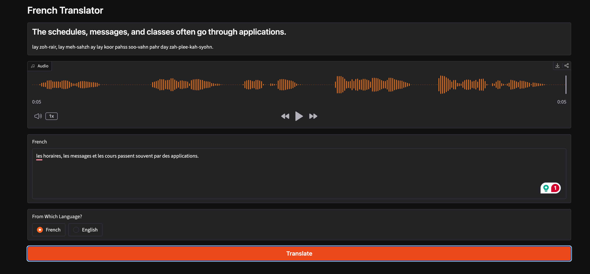

# French Translator

A personal project for learning the core features of large language models (LLMs) by building something small and real: a web app that translates between English and French, shows how to pronounce the French, and reads it aloud.



## What it does

Choose the source language, type your text and click **Translate**. The app shows:

- the translation (English → French or French → English)
- an English-style pronunciation guide for the French text (e.g. *bohn-zhoor, koh-mahn sah vah?*)
- an audio clip of the French text, which plays automatically

## What I'm learning

Each feature in the app is there to practise one LLM building block:

| LLM feature | Where it's used |
| --- | --- |
| Chat completions and system prompts | A separate system prompt for each translation direction |
| Structured output | The model replies in JSON (`translation`, `pronunciation`), which the app parses |
| Tool calling | OpenAI asks for a `get_pronunciation` tool; the app runs it and sends the result back until the model gives a final answer |
| Using more than one provider | The tool is fulfilled by Gemini, called through its OpenAI-compatible endpoint |
| Text-to-speech | The French text is turned into audio |

### How the tool call works

1. The app sends the text to OpenAI along with the definition of the `get_pronunciation` tool.
2. OpenAI replies with a request to call the tool, not with an answer.
3. The app calls Gemini to get the pronunciation.
4. The app sends that result back to OpenAI.
5. OpenAI returns the final JSON with the translation and pronunciation.

The tool requests and results are printed to the terminal so you can follow the exchange.

## Models

- `gpt-4o-mini` (OpenAI) for translation and for deciding when to call the tool
- `gemini-3.8-flash` (Google) for the pronunciation guide
- `gpt-4o-mini-tts` (OpenAI) for speech

The web interface is built with [Gradio](https://www.gradio.app/).

## Requirements

- Python 3.13+
- [uv](https://docs.astral.sh/uv/)
- An OpenAI API key
- A Gemini API key

## Setup

1. Install dependencies:

   ```sh
   uv sync
   ```

2. Create a `.env` file in the project root with your API keys:

   ```sh
   OPENAI_API_KEY=sk-...
   GEMINI_API_KEY=...
   ```

   The app loads this file on startup and exits with an error if either key is missing.

## Running

```sh
uv run python -m french_translator
```

Then open http://127.0.0.1:7860 in your browser.

## Project layout

```
docs/
└── screenshot.png    # image used in this README
src/french_translator/
├── __main__.py       # entry point: python -m french_translator
└── app.py            # translation, tool calling, text-to-speech and Gradio UI
```
